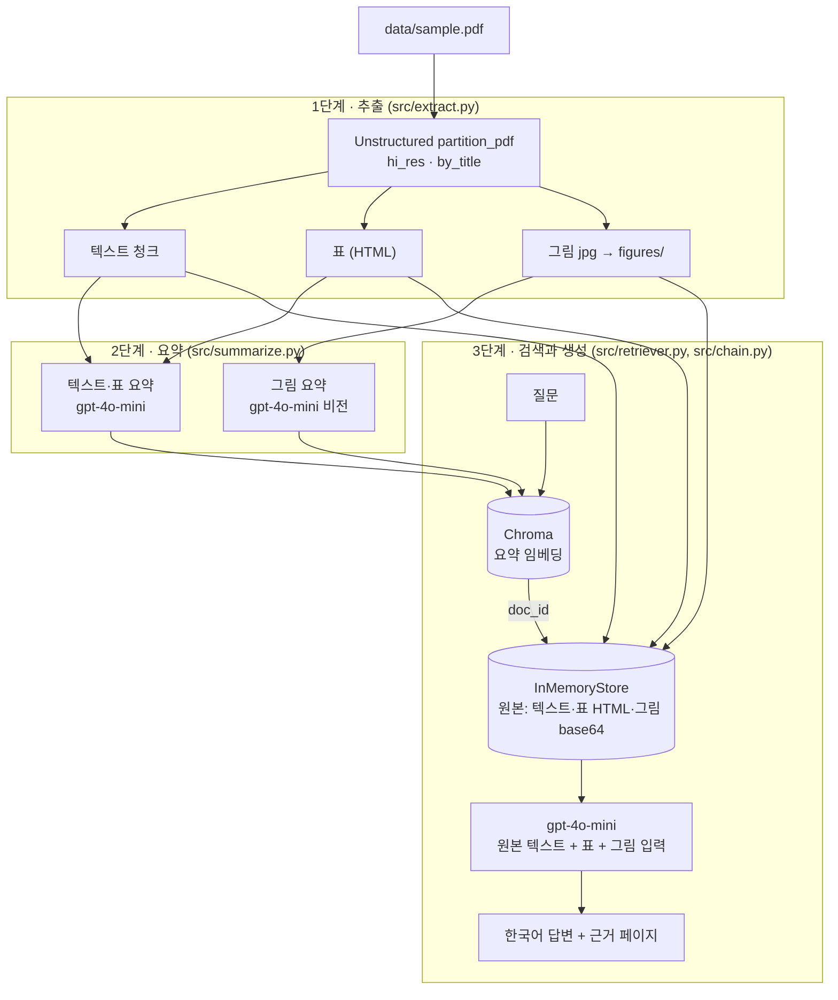

# 멀티모달 RAG — 논문 PDF의 표·그림까지 근거로 답하기

## 1. 문제 정의

- 분석 자료: Yang Song, Stefano Ermon, *Generative Modeling by Estimating Gradients of the Data Distribution* (NeurIPS 2019, [arXiv:1907.05600](https://arxiv.org/abs/1907.05600)), 23쪽
- 이 논문의 핵심 결과는 **본문이 아니라 표와 그림에 있습니다.**
  - CIFAR-10 정량 비교(Inception, FID)는 **Table 1**에만 모델별로 정리돼 있습니다.
  - 방법의 동기(저밀도 영역에서 score 추정이 부정확함)는 **Figure 1·2**, annealed Langevin dynamics의 효과는 **Figure 3**, 생성·인페인팅 결과는 **Figure 4~6**과 부록 그림으로 제시됩니다.
- 텍스트만 추출하는 RAG는 표가 한 줄 문자열로 깨지고 그림은 통째로 빠지기 때문에, "Table 1에서 NCSN보다 점수가 높은 모델은?", "Figure 2의 빨간 사각형은 무엇인가?" 같은 질문에 근거를 찾지 못합니다.
- 목표: 텍스트·표·그림을 모두 검색 대상으로 만들고, 답변할 때는 **원본 표·그림을 LLM이 직접 보게** 해서 근거 있는 한국어 답변을 만듭니다.

## 2. 아키텍처



### 왜 요약으로 검색하고 원본으로 생성하나요?

- **검색을 요약으로 하는 이유**: 표 HTML은 태그와 숫자가 대부분이라 임베딩해도 "무엇을 비교한 표인지"가 잘 드러나지 않고, 그림은 그 자체로 텍스트 임베딩을 할 수 없습니다. 요약은 표·그림의 의미를 문장으로 바꿔 주기 때문에 질문과 같은 공간에서 비교할 수 있습니다.
- **생성을 원본으로 하는 이유**: 요약은 짧게 줄이는 과정에서 수치(예: `8.87 ± .12`)나 그림의 세부가 빠질 수 있습니다. 검색은 요약으로 하되, 답변 단계에서는 `doc_id`로 원본을 꺼내 LLM이 표 전체와 그림 자체를 보게 합니다.
- 두 저장소는 `MultiVectorRetriever`가 `doc_id` 하나로 연결합니다.

## 3. 기술 선택 근거

| 항목 | 선택 | 근거 |
| --- | --- | --- |
| 파서 | Unstructured `partition_pdf`, `strategy="hi_res"` | `fast`는 텍스트만 추출합니다. 표 구조(`infer_table_structure`)와 그림 영역 추출(`extract_image_block_types`)은 레이아웃 모델을 쓰는 `hi_res`에서만 됩니다. |
| 청크 | `by_title`, `max_characters=1500`, `combine_text_under_n_chars=200` | 논문은 섹션 제목(Introduction, Experiments 등) 단위로 내용이 나뉘어 있어 제목 기준 청킹이 의미를 보존합니다. 수치는 수업 실습 2와 같은 값입니다. |
| 요약·생성 모델 | `gpt-4o-mini` | 텍스트와 이미지 입력을 모두 지원해 한 모델로 처리할 수 있고, 텍스트 청크·그림 수십 개를 요약해도 비용이 낮습니다. |
| 임베딩 | `text-embedding-3-small` | 다국어를 지원해 한국어 질문과 한국어 요약을 비교할 수 있습니다. |
| 프롬프트 언어 | 한국어 요약, 수치·모델명·데이터셋명은 원문 표기 유지 | 질문을 한국어로 하므로 요약도 한국어로 만들어 검색 정확도를 높이고, 영어 고유명사와 숫자는 그대로 두어 원문과 대조할 수 있게 했습니다. |
| 벡터 DB | Chroma (메모리) | 문서 한 편 규모라 별도 서버 없이 노트북 안에서 충분합니다. |

## 4. 실행 방법

```powershell
py -3.11 -m venv .venv
.\.venv\Scripts\Activate.ps1
python -m pip install -r requirements.txt
python -m ipykernel install --user --name multimodal-rag --display-name "Python (multimodal-rag)"
copy .env.example .env   # .env에 OPENAI_API_KEY 입력
```

1. Poppler와 Tesseract를 설치하고 PATH에 추가합니다 (`hi_res` 파싱에 필요).
2. 분석 PDF를 `data/sample.pdf`로 둡니다. PDF는 저장소에 포함하지 않습니다 (위 arXiv 링크에서 받을 수 있습니다).
3. `notebooks/multimodal_rag.ipynb`를 위에서부터 실행합니다.

```text
.
├── .env.example
├── data/                       # 분석 PDF (Git 제외)
├── figures/                    # 추출된 그림 (Git 제외)
├── notebooks/
│   └── multimodal_rag.ipynb    # 실행 결과가 남은 노트북
└── src/
    ├── extract.py              # 1단계: 텍스트·표·이미지 추출
    ├── summarize.py            # 2단계: 텍스트·표·이미지 요약
    ├── retriever.py            # 3단계: 요약 검색 → 원본 반환 (+ Before용 텍스트 검색기)
    └── chain.py                # 3단계: 원본으로 답변 생성
```

## 5. Before / After

- Before: 텍스트 청크 원문만 임베딩한 텍스트 RAG
- After: 요약 검색 + 원본(텍스트·표·그림) 생성 멀티모달 RAG

<!-- 노트북 'Before / After' 셀 출력 캡처를 넣고, 차이를 설명하세요. -->


(실행 후 작성: 어떤 질문에서 차이가 났고, 왜 그런지)

## 6. 질의응답 5건

<!-- 노트북 마지막 셀이 출력한 표를 그대로 붙여 넣으세요. -->

| # | 질문 | 답변 | 근거가 된 원본 종류 |
| --- | --- | --- | --- |
| 1 | CIFAR-10 unconditional 설정에서 NCSN의 Inception score와 FID는 각각 얼마인가요? | (실행 후 작성) | |
| 2 | Table 1에서 Inception score가 NCSN보다 높은 모델은 무엇이고, 어떤 설정인가요? | (실행 후 작성) | |
| 3 | Figure 2에서 빨간 사각형으로 표시된 영역은 무엇을 의미하나요? | (실행 후 작성) | |
| 4 | Figure 3에서 annealed Langevin dynamics와 일반 Langevin dynamics의 결과는 어떻게 다른가요? | (실행 후 작성) | |
| 5 | 이미지 생성 실험에서 노이즈 수준 σ는 몇 개, 어떤 범위로 설정했나요? | (실행 후 작성) | |

## 7. 한계

- 수식이 많은 논문이라 PDF 텍스트 추출 시 위첨자·아래첨자·그리스 문자가 깨진 채로 청크에 들어갑니다 (예: `qσ2 (x)`). 수식 관련 질문은 정확도가 떨어질 수 있습니다.
- `hi_res` 레이아웃 인식 결과에 따라 그림 하나가 여러 조각으로 잘리거나, 캡션이 그림과 다른 청크로 분리될 수 있습니다.
- 그림 요약은 비전 모델의 해석이므로 작은 글자·범례를 잘못 읽을 수 있습니다. 답변 단계에서 원본 그림을 다시 보여 주는 것으로 일부 보완합니다.
- 검색기와 docstore는 메모리에만 있어 노트북을 다시 열면 요약(API 호출)부터 다시 실행해야 합니다.
- 상위 k=4개만 검색하므로, 여러 표·그림을 함께 비교해야 하는 질문은 근거가 일부 빠질 수 있습니다.

## 8. 보안

- API 키는 `.env`에만 두고 `.gitignore`로 제외합니다. 저장소에는 키 이름만 있는 `.env.example`만 포함합니다.
- 노트북에는 키 앞 4자리만 출력합니다.
