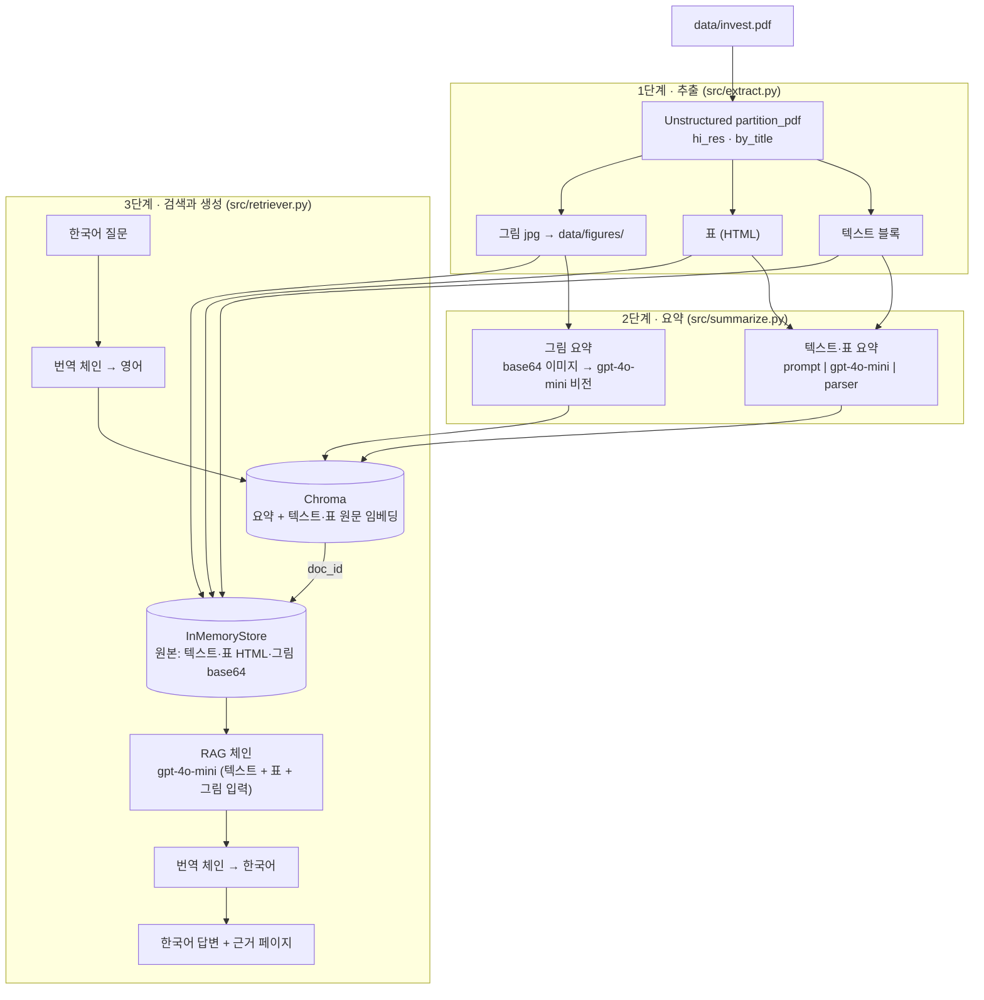
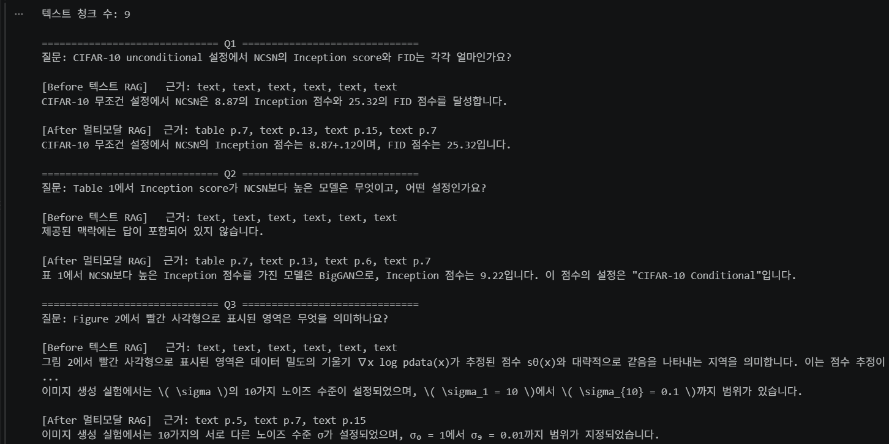
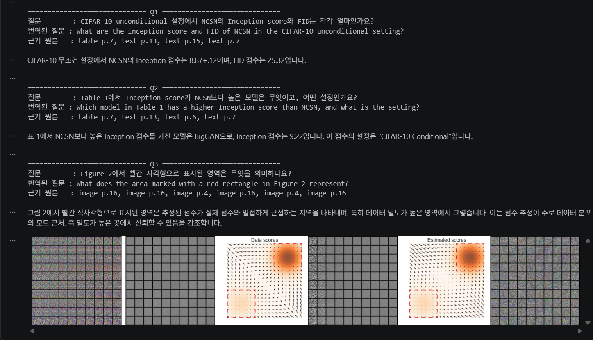
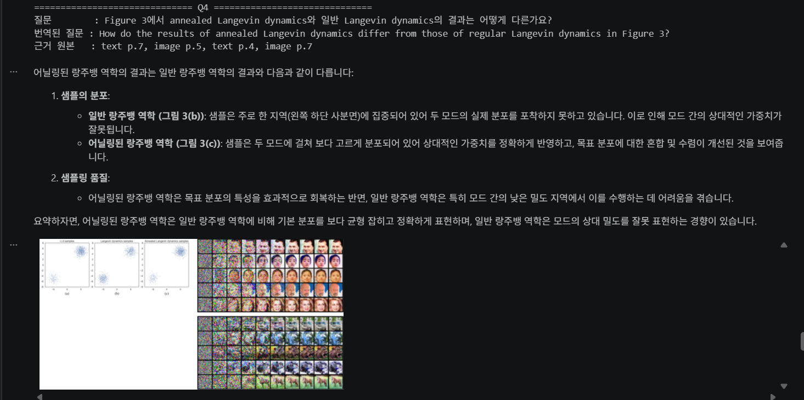
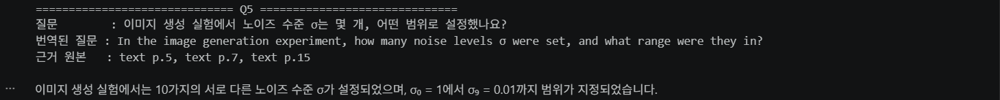

# 멀티모달 RAG — 논문 PDF의 표·그림까지 근거로 답하기

## 1. 문제 정의

- 분석 자료: Yang Song, Stefano Ermon, *Generative Modeling by Estimating Gradients of the Data Distribution* (NeurIPS 2019, [arXiv:1907.05600](https://arxiv.org/abs/1907.05600)), 23쪽
- 이 논문의 핵심 결과는 **본문이 아니라 표와 그림에 있습니다.**
  - CIFAR-10에서 다른 모델들과의 정량 비교(Inception, FID)는 **Table 1**에만 정리돼 있습니다. 본문에는 NCSN 자신의 점수만 나옵니다.
  - 방법의 동기(데이터가 적은 저밀도 영역에서 score 추정이 부정확함)는 **Figure 1·2**, annealed Langevin dynamics의 효과는 **Figure 3**, 생성·인페인팅 결과는 **Figure 4~6**과 부록 그림으로 제시됩니다.
- 텍스트만 추출하는 RAG는 표가 한 줄 문자열로 깨지고 그림은 통째로 빠집니다. 그래서 "Table 1에서 NCSN보다 점수가 높은 모델은?"처럼 **표에만 있는 정보**는 찾지 못하고, 비슷한 설정이 여러 실험에 흩어져 있으면 다른 실험의 값을 가져오기도 합니다 (6. Before / After 참고).
- 목표: 텍스트·표·그림을 모두 검색 대상으로 만들고, 답변할 때는 **원본 표·그림을 LLM이 직접 보게** 해서 근거 있는 한국어 답변을 만듭니다.

## 2. 아키텍처



### 왜 요약으로 검색하고 원본으로 생성하나요?

- **검색을 요약으로 하는 이유**: 표 HTML은 태그와 숫자가 대부분이라 그대로 임베딩하면 "무엇을 비교한 표인지"가 잘 드러나지 않습니다. 그림은 텍스트 임베딩을 아예 할 수 없습니다. 요약은 표·그림의 의미를 문장으로 바꿔 주기 때문에 질문과 같은 공간에서 비교할 수 있습니다.
- **생성을 원본으로 하는 이유**: 요약은 짧게 줄이는 과정에서 수치(예: `8.87 ± .12`)나 그림의 세부가 빠질 수 있습니다. 검색은 요약으로 하되, 답변 단계에서는 `doc_id`로 원본을 꺼내 LLM이 표 전체와 그림 자체를 보게 합니다.
- 두 저장소는 `MultiVectorRetriever`가 `doc_id` 하나로 연결합니다.

## 3. 기술 선택 근거

| 항목 | 선택 | 근거 |
| --- | --- | --- |
| 파서 | Unstructured `partition_pdf`, `strategy="hi_res"` | `fast`는 텍스트만 추출합니다. 표 구조(`infer_table_structure`)와 그림 추출(`extract_images_in_pdf`)은 레이아웃 모델을 쓰는 `hi_res`에서만 됩니다. |
| 청크 | `by_title`, 4000 / 3800 / 2000자 | 논문은 섹션 제목 단위로 내용이 나뉘어 있어 제목 기준이 의미를 보존합니다. 블록이 요약 단위가 되므로 섹션 하나가 통째로 들어가도록 크게 잡았습니다 (수업 01 설정). |
| 요약·생성 모델 | `gpt-4o-mini` | 텍스트와 이미지 입력을 모두 지원해 요약·비전·답변·번역을 한 모델로 처리하고, 블록·그림 수십 개를 요약해도 비용이 낮습니다. |
| 임베딩 | `text-embedding-3-small` | 텍스트 요약을 검색하므로 텍스트 임베딩으로 충분합니다. |
| 그림 검색 방식 | CLIP 대신 **그림 요약 + 텍스트 임베딩** | FashionRAG처럼 CLIP으로 그림을 직접 검색할 수도 있지만, CLIP은 일반 사진–캡션으로 학습돼 그래프·샘플 격자처럼 논문 그림의 의미("저밀도 영역에서 score가 부정확")를 잘 잡지 못합니다. 그림을 문장으로 요약하면 텍스트·표와 같은 검색기 하나로 다룰 수 있습니다. |
| 프롬프트 언어 | 요약·답변 프롬프트는 **영어**, 질문·답변은 **번역 체인**으로 한↔영 | 논문 원문이 영어라 영어 요약이 원문 용어(score matching, Langevin dynamics 등)를 그대로 유지합니다. 한국어 질문은 FashionRAG처럼 번역 체인으로 영어로 바꿔 검색하고, 답변은 다시 한국어로 번역합니다. |
| 검색 색인 | 요약 + 텍스트·표 원문을 같은 `doc_id`로 함께 임베딩, k=6 | 첫 실행에서 요약이 세부 수치를 빠뜨려 해당 내용이 검색되지 않는 문제가 있었습니다 (예: 노이즈 수준 σ 설정). 원본 하나에 요약 벡터와 원문 벡터를 모두 연결해, 의미 검색은 요약으로, 세부 수치는 원문으로 걸리게 했습니다. |
| 요약 프롬프트 | 수치·설정값 보존, 표는 모든 행·열 나열, 그림은 같은 페이지 본문(캡션) 함께 입력 | 첫 실행에서 표 요약이 Inception 열을 빼먹고, 그림 요약이 캡션을 몰라 "빨간 사각형"의 의미를 설명하지 못했습니다. |
| 표 필터 | 행 3개 미만 또는 빈 칸 50% 초과 블록 제외 | hi_res가 저자 이메일 줄과 벡터장 그림(Figure 2)을 표로 잘못 인식해 검색 결과를 오염시켰습니다. |
| 벡터 DB | Chroma (메모리) | 문서 한 편 규모라 별도 서버 없이 충분합니다. 추출·요약 결과는 pickle로 저장해 재실행 비용을 줄입니다. |

## 4. 수업 외 추가·변경 사항

수업 자료(01 데이터 추출, FashionRAG, rag-parser 실습) 이외에 추가하거나 바꾼 부분입니다.

| 구분 | 위치 | 수업 내용 | 추가·변경한 내용 | 이유 |
| --- | --- | --- | --- | --- |
| 추출 | `src/extract.py` `categorize_elements` | `str(element)`만 저장 | 페이지 번호와 표 HTML(`text_as_html`)을 함께 저장 | 답변에 근거 페이지를 표시하고, 표의 행·열 구조를 답변 단계까지 유지하기 위해 |
| 추출 | `src/extract.py` `is_valid_table` | 없음 | 행 3개 미만이거나 빈 칸이 50%를 넘는 "표"는 제외 | hi_res가 저자 이메일 줄(p.1)과 Figure 2 벡터장 그림(p.4)을 표로 잘못 인식해 검색 결과를 차지했기 때문 |
| 추출 | `src/extract.py` `list_figures` | 폴더의 이미지 목록만 출력 | 파일명(`figure-<페이지>-<번호>.jpg`)에서 페이지를 읽어 그림마다 페이지 정보 부여 | 그림도 근거 페이지를 표시하고, 같은 페이지 본문(캡션)과 연결하기 위해 |
| 추출 | `src/extract.py` `extract_pdf_elements` | 없음 | 추출 전에 이전 jpg 삭제 | 다시 실행할 때 예전 그림이 섞이지 않게 |
| 요약 | `src/summarize.py` 텍스트 프롬프트 | 없음 | 수치·하이퍼파라미터·실험 설정을 빠짐없이 남기도록 지시 | 첫 실행에서 요약이 σ 설정값을 빠뜨려 해당 질문(Q5)이 검색되지 않았기 때문 |
| 요약 | `src/summarize.py` 표 프롬프트 | 없음 | 모든 행의 모든 열 값을 나열하도록 지시 | 첫 실행에서 Table 1 요약이 Inception 열을 통째로 빠뜨려 Q2에 답하지 못했기 때문 |
| 요약 | `src/summarize.py` `summarize_images` | FashionRAG: 이미지와 질문만 전달 | 같은 페이지 본문(캡션 포함)을 이미지와 함께 전달 | 논문 그림의 의미(예: Figure 2의 빨간 사각형)는 캡션에만 있어서, 이미지만으로는 설명할 수 없었기 때문 |
| 검색 | `src/retriever.py` | rag-parser: 원문을 잘게 나눈 조각으로 검색 | 원본 하나에 **요약 벡터 + 원문 벡터**를 같은 `doc_id`로 연결 | 의미 검색은 요약으로, 요약에서 빠진 세부 수치는 원문으로 걸리게 하기 위해 |
| 검색 | `src/retriever.py`, 노트북 `[3]` | rag-parser: 기본값 | 검색 개수 k=6 | 원본 하나에 벡터가 2개라 같은 원본이 중복으로 걸리는데, 중복을 합친 뒤에도 근거를 충분히 확보하기 위해 |
| 검색 | `src/retriever.py` | FashionRAG: `PersistentClient`(디스크 저장) | 메모리 Chroma + 실행마다 다른 컬렉션 이름 | 셀을 다시 실행할 때 같은 요약이 중복 저장되지 않게 |
| 생성 | `src/retriever.py` `create_rag_chain` | FashionRAG: 이미지 2장 고정 프롬프트 | `MessagesPlaceholder`로 검색된 그림 수만큼(0장 이상) 전달 | 질문마다 검색되는 그림 수가 달라서 |
| 생성 | `src/retriever.py` `format_prompt_inputs` | FashionRAG: 이미지만 전달 | 그림과 함께 그림 요약(캡션 정보 포함)도 텍스트로 전달 | 비전 모델이 그림 속 표시의 의미를 캡션 기준으로 설명할 수 있도록 |
| 생성 | `src/retriever.py` 시스템 프롬프트 | 없음 | "PDF 추출 과정에서 σ가 o나 0으로 깨질 수 있다"는 안내 추가 | 실제로 `σ1 = 1`이 `0, = 1`로 OCR돼 모델이 근거를 알아보지 못했기 때문 |
| 생성 | `src/retriever.py` `sources` | 없음 | 근거 원본의 종류와 페이지 출력 (예: `table p.7, image p.4`) | 과제의 "근거가 된 원본 종류"를 표시하기 위해 |
| 저장 | `src/extract.py`, `src/summarize.py` `load_or_*` | 노트북 01: 추출 결과만 pickle 저장 | 요약 결과도 pickle 저장 | 다시 실행할 때 API 비용과 시간을 아끼기 위해 |
| 환경 | 노트북 `[1]` `find_project_root` | 노트북 위치를 가정 | `src/extract.py`가 있는 폴더를 찾아 이동 | 실행 위치(VS Code, Jupyter)에 따라 `ModuleNotFoundError: src`가 났기 때문 |
| 구조 | `src/*.py` 의 `__main__` | 실습 코드는 노트북 안에 작성 | 추출·요약·검색·체인을 모두 `src/`에 두고, 노트북은 불러와 실행·출력만 함. 각 파일을 `python -m src.<파일>`로 단독 실행 가능 | 노트북 없이도 같은 결과를 재현할 수 있게 하고, 코드가 노트북과 `src/`에 중복되지 않게 하기 위해 |
| 환경 | `requirements.txt` | `unstructured[all-docs]` | `unstructured[pdf]` 추가, 주석은 영어로만 | `[all-docs]`만으로는 hi_res 레이아웃 모델(`unstructured_inference`)이 설치되지 않았고, 한글 주석 때문에 Windows pip가 파일을 못 읽었기 때문 |

## 5. 실행 방법

```powershell
python -m venv .venv
.\.venv\Scripts\Activate.ps1
python -m pip install -r requirements.txt
copy .env.example .env   # .env에 OPENAI_API_KEY 입력
```

1. Poppler와 Tesseract를 설치하고 PATH에 추가합니다 (`hi_res` 파싱에 필요).
2. 분석 PDF는 `data/invest.pdf`로 저장소에 포함돼 있습니다 (출처: 위 arXiv 링크).
3. `notebooks/Multi_modal_RAG.ipynb`를 위에서부터 실행합니다.
4. 노트북 없이 `src/`만으로도 실행할 수 있습니다 (프로젝트 루트에서).

   ```powershell
   python -m src.extract              # 1단계 추출 → data/processed/extracted.pkl
   python -m src.summarize            # 2단계 요약 → data/processed/summaries.pkl
   python -m src.retriever            # 3단계 검색·답변: 질의응답 5건 출력
   python -m src.retriever --before   # + Before(텍스트 RAG) 비교 출력
   ```

   `src.retriever`는 저장본이 없으면 추출·요약부터 자동으로 실행합니다.

```text
multimodal-rag/
├── .venv/                      # 가상환경 (Git 제외)
├── .env                        # API 키 (Git 제외, 절대 커밋 금지)
├── .env.example                # 키 없는 템플릿 (Git 포함)
├── .gitignore
├── requirements.txt            # 의존성 목록
├── requirements.lock.txt       # 버전 고정 파일
├── README.md
├── data/
│   ├── invest.pdf              # 원본 PDF
│   └── figures/                # 추출된 이미지 (Git 제외, 용량 큼)
├── images/                     # README용 실행 결과 캡처
├── notebooks/
│   └── Multi_modal_RAG.ipynb   # 실습 노트북 (번역 체인·RAG 체인·전체 파이프라인 포함)
└── src/
    ├── extract.py              # PDF 파싱 함수
    ├── summarize.py            # 요약 체인
    └── retriever.py            # 다중 벡터 검색기 + 번역·RAG 체인
```

노트북을 실행하면 추출·요약 결과가 `data/processed/`에 pickle로 저장됩니다 (Git 제외).

## 6. Before / After — 텍스트 RAG vs 멀티모달 RAG (질의응답 5건)

- **Before · 텍스트 RAG**: 텍스트를 2000토큰 / overlap 200으로 자른 청크 원문만 임베딩해 검색하고, 텍스트만으로 답변합니다. 표·그림·요약은 쓰지 않습니다.
- **After · 멀티모달 RAG**: 텍스트·표·그림 요약(+ 텍스트·표 원문)으로 검색하고, 원본 텍스트·표 HTML·그림으로 답변합니다.
- 번역 체인, RAG 체인, 검색 개수(k=6)는 같고 **검색 대상만** 다릅니다. (노트북 `[13]`~`[15]`, Part 7)

### 6-1. Before · 텍스트 RAG 출력

<!-- 노트북 [15] 출력에서 Before 답변 부분을 캡처해 images/ 에 넣고 아래 경로를 맞추세요 -->


근거는 5건 모두 텍스트 청크(text × 6)입니다.

| # | 질문 | 답변 |
| --- | --- | --- |
| Q1 | CIFAR-10 unconditional 설정에서 NCSN의 Inception score와 FID는 각각 얼마인가요? | CIFAR-10 무조건 설정에서 NCSN은 8.87의 Inception 점수와 25.32의 FID 점수를 달성합니다. |
| Q2 | Table 1에서 Inception score가 NCSN보다 높은 모델은 무엇이고, 어떤 설정인가요? | 제공된 맥락에는 답이 포함되어 있지 않습니다. |
| Q3 | Figure 2에서 빨간 사각형으로 표시된 영역은 무엇을 의미하나요? | 그림 2에서 빨간 사각형으로 표시된 영역은 데이터 밀도의 기울기 ∇x log pdata(x)가 추정된 점수 sθ(x)와 대략적으로 같음을 나타내는 지역을 의미합니다. 이는 점수 추정이 이러한 지역에서 신뢰할 수 있음을 나타내며, 이러한 지역은 일반적으로 데이터 밀도가 높은 데이터 분포의 모드 근처에 위치합니다. |
| Q4 | Figure 3에서 annealed Langevin dynamics와 일반 Langevin dynamics의 결과는 어떻게 다른가요? | 그림 3에서, 풀림된 Langevin 동역학의 결과(서브그림 (c)에서 보여짐)는 일반 Langevin 동역학의 결과(서브그림 (b)에서 보여짐)와 다릅니다. 풀림된 Langevin 동역학은 가우시안 혼합의 두 모드 간의 상대적인 가중치를 올바르게 회복하는 반면, 표준 Langevin 동역학은 그렇게 하지 못합니다. 이는 풀림된 접근 방식이 일반 Langevin 동역학에 비해 데이터 분포의 구조를 포착하는 데 더 효과적임을 나타냅니다. |
| Q5 | 이미지 생성 실험에서 노이즈 수준 σ는 몇 개, 어떤 범위로 설정했나요? | 이미지 생성 실험에서는 \( \sigma \)의 10가지 노이즈 수준이 설정되었으며, \( \sigma_1 = 10 \)에서 \( \sigma_{10} = 0.1 \)까지 범위가 있습니다. |

### 6-2. After · 멀티모달 RAG 출력 (질의응답 5건)





| # | 질문 | 답변 | 근거가 된 원본 종류 |
| --- | --- | --- | --- |
| 1 | CIFAR-10 unconditional 설정에서 NCSN의 Inception score와 FID는 각각 얼마인가요? | CIFAR-10 무조건 설정에서 NCSN의 Inception 점수는 8.87+.12이며, FID 점수는 25.32입니다. | table, text (table p.7, text p.13, text p.15, text p.7) |
| 2 | Table 1에서 Inception score가 NCSN보다 높은 모델은 무엇이고, 어떤 설정인가요? | 표 1에서 NCSN보다 더 높은 Inception 점수를 가진 모델은 BigGAN으로, Inception 점수는 9.22입니다. 이 점수의 설정은 "CIFAR-10 Conditional"입니다. | table, text (table p.7, text p.13, text p.6, text p.7) |
| 3 | Figure 2에서 빨간 사각형으로 표시된 영역은 무엇을 의미하나요? | 그림 2에서 빨간 사각형으로 표시된 영역은 추정된 점수가 실제 점수와 밀접하게 근접하는 지역을 나타내며, 특히 데이터 밀도가 높은 영역에서 그렇습니다. 이는 점수 추정이 데이터 분포의 모드 근처, 즉 밀도가 높은 곳에서만 신뢰할 수 있음을 강조합니다. | image (image p.16, image p.16, image p.16, image p.4, image p.16, image p.17) |
| 4 | Figure 3에서 annealed Langevin dynamics와 일반 Langevin dynamics의 결과는 어떻게 다른가요? | 어닐링된 랑주뱅 역학의 결과는 일반 랑주뱅 역학의 결과와 다음과 같이 다릅니다:  1. **샘플 분포**:    - **일반 랑주뱅 역학 (그림 3(b))**: 샘플이 주로 한 지역(왼쪽 하단 사분면)에 집중되어 있어 두 모드의 분포를 정확하게 포착하지 못하고 있습니다. 이로 인해 모드 간의 상대적인 가중치가 잘못됩니다.    - **어닐링된 랑주뱅 역학 (그림 3(c))**: 샘플이 두 모드에 걸쳐 더 고르게 분포되어 상대적인 가중치를 성공적으로 회복합니다. 이는 목표 분포에 대한 혼합 및 수렴이 개선되었음을 나타냅니다.  2. **샘플링 품질**:    - 어닐링된 랑주뱅 역학 방법은 모드 간의 저밀도 영역을 탐색하는 데 더 나은 능력을 보여주며, 일반 랑주뱅 역학에 비해 실제 분포를 더 정확하게 반영하는 고품질 샘플을 생성합니다.  요약하자면, 어닐링된 랑주뱅 역학은 목표 분포의 특성을 효과적으로 포착하는 반면, 일반 랑주뱅 역학은 모드 분리에 어려움을 겪고 편향된 샘플을 생성합니다. | image, text (text p.7, image p.5, text p.4, image p.7) |
| 5 | 이미지 생성 실험에서 노이즈 수준 σ는 몇 개, 어떤 범위로 설정했나요? | 이미지 생성 실험에서는 10가지 서로 다른 노이즈 수준 σ가 설정되었으며, σ₀ = 1에서 σ₉ = 0.01까지 범위가 지정되었습니다. | text (text p.5, text p.7, text p.15) |

### 6-3. Before / After 비교

| 질문 | Before (텍스트 RAG) | After (멀티모달 RAG) | 차이의 이유 |
| --- | --- | --- | --- |
| Q1 Inception·FID | 정답 (8.87 / 25.32) | 정답 (8.87±.12 / 25.32) | 본문 p.7에도 "8.87, 25.32"가 적혀 있어 둘 다 답함. 오차 범위(±.12)는 Table 1에만 있어 After만 답함 |
| Q2 NCSN보다 높은 모델 | **답 못 함** | 정답 (BigGAN 9.22, CIFAR-10 Conditional) | BigGAN의 9.22는 **Table 1에만** 있는 값이라 텍스트 청크로는 찾을 수 없음 |
| Q3 빨간 사각형 | 정답 | 정답 | 의미가 Figure 2 **캡션(본문 텍스트)**에 적혀 있어 둘 다 답함 |
| Q4 Figure 3 비교 | 정답 (본문 설명 기반) | 정답 (그림 기반으로 더 구체적) | 본문에도 결론이 있어 둘 다 답했지만, After는 Figure 3 그림을 직접 보고 (b)는 샘플이 한쪽 모드에 몰리고 (c)는 두 모드에 고르게 퍼진다는 분포 차이까지 설명함 |
| Q5 σ 설정 | **오답** (σ1 = 10 ~ σ10 = 0.1) | 정답 (10개, 1 ~ 0.01) | Before는 가우시안 혼합 장난감 실험의 σ 설정을 이미지 생성 실험 값으로 잘못 가져옴. 텍스트 청크만으로는 어느 실험의 설정인지 구분하지 못함 |

**정리**

- 이 논문은 핵심 수치와 그림 캡션을 본문에도 다시 적는 경우가 많아, 본문에 답이 있는 질문(Q1, Q3, Q4)은 텍스트 RAG도 답했습니다.
- 차이는 **표에만 있는 정보(Q2)**와 **비슷한 설정이 여러 실험에 흩어져 있는 경우(Q5)**에서 났습니다. 특히 Q5에서 텍스트 RAG는 "모른다"가 아니라 **그럴듯한 오답**을 냈습니다.
- 그림을 직접 보는 After는 같은 정답이라도 그림에서 확인한 근거로 더 구체적으로 설명했습니다(Q4).
- 남은 문제: After의 Q5 답변은 값과 개수는 맞지만, σ 번호를 논문 표기(σ1 = 1, σ10 = 0.01)와 달리 σ₀~σ₉로 표기했습니다.

## 7. 한계

- 수식이 많은 논문이라 텍스트 추출 시 위첨자·아래첨자·그리스 문자가 깨진 채로 들어갑니다 (예: `σ1 = 1`이 `0, = 1`로 OCR됨). RAG 프롬프트에 OCR 깨짐 가능성을 알려 보완했지만, 수식 관련 질문은 정확도가 떨어질 수 있습니다.
- 논문 옆 세로 arXiv 표기 같은 텍스트가 글자 단위로 흩어져 첫 블록에 노이즈로 섞입니다.
- `hi_res` 레이아웃 인식 결과에 따라 그림 하나가 여러 조각으로 잘리거나, 캡션이 그림과 다른 블록으로 분리될 수 있습니다.
- 그림 요약은 비전 모델의 해석이라 작은 글자·범례를 잘못 읽을 수 있습니다. 답변 단계에서 원본 그림을 다시 보여 주는 것으로 일부 보완합니다.
- 번역을 두 번 거치므로 질문의 뉘앙스나 용어가 바뀔 수 있고, 질문 하나에 API 호출이 3번 발생합니다.
- 상위 k=6개 벡터만 검색하므로, 여러 표·그림을 함께 비교해야 하는 질문은 근거가 일부 빠질 수 있습니다.

## 8. 보안

- API 키는 `.env`에만 두고 `.gitignore`로 제외합니다. 저장소에는 키 이름만 있는 `.env.example`만 포함합니다.
- 노트북에는 키 앞 4자리만 출력합니다.
